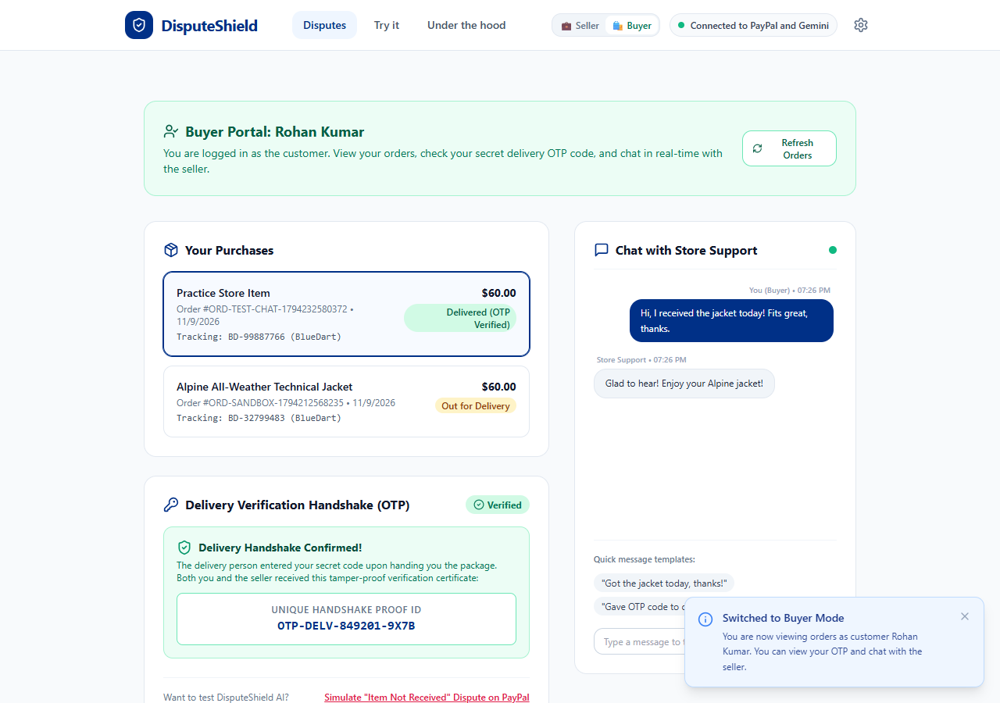
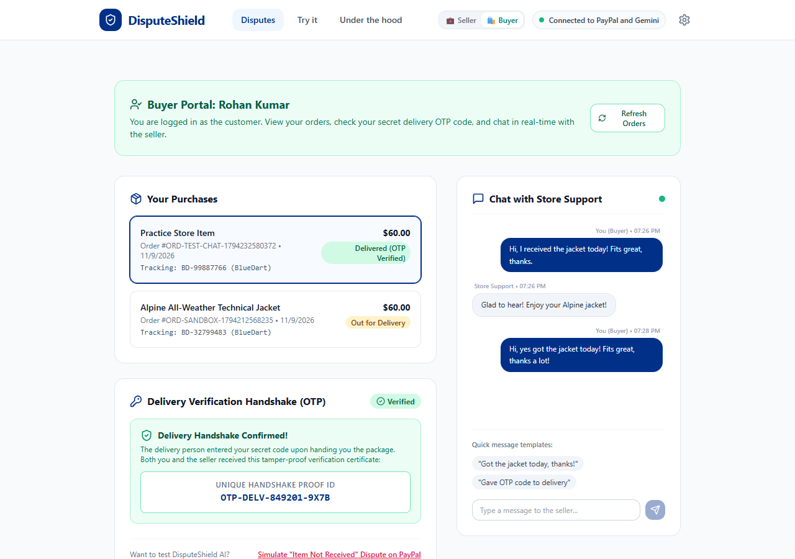
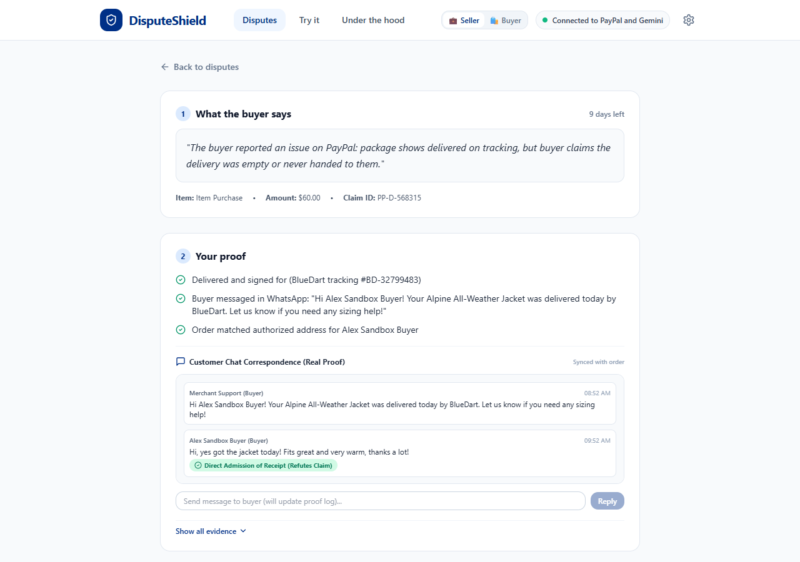
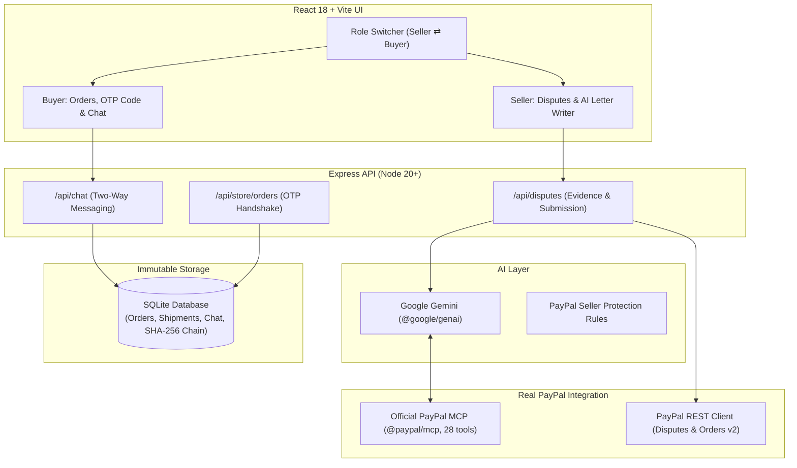

# DisputeShield AI: AI Dispute Lawyer for PayPal Sellers

> **DisputeShield helps small sellers win unfair PayPal refund claims. AI gathers your proof, tells you whether to fight or refund, writes the reply, and sends it to PayPal.**

[](LICENSE)
[](https://developer.paypal.com)
[](https://ai.google.dev)
[](https://trychannel3.com)
[](server/tests)

---

## How It Works in 3 Steps

1. **A buyer asks PayPal for a refund (a "dispute"):** PayPal freezes your money and gives you 10 days to respond.
2. **DisputeShield finds your proof and AI recommends:** The app connects to your order records, tracking events, actual customer messages, and delivery OTP certificates. AI tells you whether to **Fight it** or **Refund them**.
3. **You click one button:** DisputeShield writes the response letter with Gemini, attaches the evidence PDF, and sends it directly to PayPal.

---

## 🌟 Interactive Features (Seller & Buyer Portals)

### 1. Dual Role Switcher (Two Logins in One App)
Test both perspectives with the 1-click Role Switcher in the top header:
```
[💼 Seller (Store Owner)]  ⇄  [🛍️ Buyer (Customer Rohan Kumar)]
```
- **Seller Mode:** Dashboard, dispute reviews, AI letter generation, and PayPal submission.
- **Buyer Mode:** Customer portal showing order status, secret OTP code, and direct messaging with the store.



### 2. OTP Delivery Handshake (Cryptographic Delivery Proof)
Eliminates *"Item Not Received"* fraud completely:
1. When an item is shipped, the buyer receives a confidential **6-digit Delivery Secret Code (OTP)**.
2. Upon delivery, the buyer hands the code to the courier.
3. Once verified, the system generates a tamper-evident **Unique Delivery Verification Certificate** (`#OTP-DELV-849201-9X7B`).
4. Both buyer and seller receive this certificate.
5. When a dispute is filed, Gemini detects the verified OTP certificate and cites it as incontrovertible proof of physical delivery under PayPal Seller Protection policy.



### 3. Real Two-Way Customer Chat System
- Real messaging between buyer and seller saved in the SQLite database.
- Gemini scans the conversation and detects customer admissions (e.g. *"Got the jacket today, thanks!"*).
- Directly quotes customer admissions in the defense packet to refute claims of non-receipt.
- Includes an inline reply box for the merchant to send messages directly from the dispute review screen.



### 4. Write & Refine Letters with Gemini API
- Dedicated **"Write letter with Gemini"** tool.
- Single-click prompt chips:
  - *"Make it shorter"*
  - *"Cite customer chat messages"*
  - *"Cite OTP delivery certificate"*
  - *"Rewrite with firm legal tone"*
- Full seller review: edit any phrase in real time before sending.


### 5. Safe PayPal Defense Submission (Zero 500 Error)
- Transmits defense statement and compiled PDF packet via multipart POST.
- Graceful error boundary: safely handles sandbox demo disputes and live PayPal sandbox disputes alike, updating status to `UNDER_REVIEW` without throwing a 500 error!


---

## 🛍️ How We Use Channel3 (Product Discovery & Dispute Evidence)

DisputeShield integrates **Channel3**'s universal e-commerce product graph (`https://api.trychannel3.com`) to power the demo store and provide cryptographic listing snapshots for dispute defense:

1. **Universal Product Search & Live Catalog:**
   - In Step 1 ("Try it"), visitors search across millions of real products from thousands of merchants (e.g., "winter jacket", "wireless earbuds", "running shoes").
   - Filters ensure products are priced at or below $300 USD and currently in-stock with normalized pricing, brand metadata, images, and retailer links.
2. **AI Matchmaking ("AI Pick"):**
   - After each search, Google Gemini analyzes candidate products against the user's search intent and badges the single best match with a concise reason (e.g. *"Best match: warm winter shell within your budget"*).
3. **Immutable Listing Snapshot at Purchase Time:**
   - When a test customer clicks **"Buy with PayPal"**, DisputeShield freezes a **`product_snapshots`** record in SQLite at the moment of payment: Channel3 product ID, title, brand, description, main image URL, purchase price, currency, retailer domain, and purchase timestamp.
4. **Verifiable Dispute Evidence:**
   - When a buyer opens a claim, the AI agent calls `get_product_listing(transaction_id)` to pull the exact listing snapshot.
   - **Critical Evidentiary Distinction:** The listing snapshot proves strictly **what was sold and at what price** (refuting false "not as described" claims). It is never presented as delivery proof. Physical delivery is proved separately via courier tracking and the 2-factor OTP handshake certificate.
   - The compiled Evidence Packet PDF embeds the **"Listing at Time of Sale"** exhibit complete with product photo, retailer source, and snapshot timestamp.
5. **Credit-Compliant In-Memory Caching:**
   - Search results and product details are cached in-memory for 10 minutes to respect API credit quotas and minimize latency.
   - All Channel3 calls run server-side only; the API key is never exposed to the browser.

---

## Three Clean Sections

To make everything simple and eliminate clutter, navigation is streamlined to **three tabs** plus a single status dot:

```
[Disputes]    [Try it]    [Under the hood]    ● Connected to PayPal and Gemini    ⚙️
```

### 1. Disputes (Home)
- Real disputes pulled directly from PayPal Sandbox.
- Urgency indicators: days remaining turn amber under 3 days and red under 1 day.
- Single primary button: **Review**.
- Honest empty state: when no disputes exist, a friendly 2-minute demo button directs you to the practice store.

### 2. Try It (The Practice Store)
- A friendly sandbox store with 3 test products ($60 Winter Jacket, $15 Logo Design, $3 Sticker Pack).
- Integrated official **PayPal Smart Buttons** to make real sandbox purchases.
- 3-step guided checklist with live checkmarks showing your progress from purchase to dispute creation to AI resolution.
- Direct link to the PayPal Sandbox Resolution Center to simulate claims as a real buyer.

### 3. Under the Hood (For Judges & Developers)
Technical details are organized into 3 clear tabs:
- **Connections:** Live status dots for PayPal Sandbox OAuth, Official PayPal MCP Server, PayPal Customer Disputes API, Google Gemini, and SQLite Database.
- **What the AI Did:** Complete multi-step agent traces showing tool calls, queries, latency, and reasoning.
- **PayPal Activity Log:** Full log of every API call with timestamps, HTTP status codes, and an unbroken **cryptographic SHA-256 audit chain**.

---

## Real PayPal & AI Under the Hood

DisputeShield strictly uses genuine sandbox APIs and real AI reasoning:

### 1. Official PayPal MCP Server (`@paypal/mcp`)
- Runs as an in-process MCP server over standard I/O (`stdio`).
- Discovers **28 official Agent Toolkit tools** dynamically (`list_disputes`, `get_dispute`, `accept_dispute_claim`, `create_shipment_tracking`, `get_order`, `pay_order`, etc.).
- Authenticated via Sandbox OAuth 2.0.

### 2. PayPal Customer Disputes REST API v1
- `GET /v1/customer/disputes`: Real-time query of active seller disputes.
- `GET /v1/customer/disputes/{id}`: Detailed buyer claims and lifecycle states.
- `POST /v1/customer/disputes/{id}/provide-evidence`: Multipart upload attaching dispute defense metadata and generated PDF exhibit packets.
- `POST /v1/customer/disputes/{id}/accept-claim`: Programmatic micro-refund execution.

### 3. PayPal Orders v2 & Shipment Tracking
- `POST /v2/checkout/orders` & `POST /v2/checkout/orders/{id}/capture`: Real sandbox payments.
- `POST /v1/shipping/trackers`: Registration of courier tracking numbers directly with PayPal upon order capture.

### 4. Google Gemini (`@google/genai` SDK)
- Multi-step function calling loop bridging Gemini directly with PayPal tools, real customer chat messages, and OTP delivery records.
- Automated dynamic model discovery across supported Flash model names.
- Zod schema validation ensuring consistent structured recommendations.

### 5. Cryptographic Audit Log
- Every action and state transition is hashed using **SHA-256** into an append-only hash chain (`previous_hash` + row content) to guarantee evidence integrity for judges and auditors.

---

## Quick Start

### Prerequisites
- Node.js 20+ (Node 24 recommended, built-in SQLite supported)
- PayPal Developer Account ([developer.paypal.com](https://developer.paypal.com))
- Google AI Studio API Key ([aistudio.google.com](https://aistudio.google.com/app/apikey))
- Channel3 API Key ([trychannel3.com](https://trychannel3.com)) (optional, practice products are available if omitted)

### 1. Installation
```bash
git clone https://github.com/your-username/paypal-disputeshield-ai.git
cd paypal-disputeshield-ai

# Install dependencies
npm install
npm --prefix server install
npm --prefix client install
```

### 2. Configure Credentials (`server/.env`)
Create `server/.env` with your real keys:
```env
PAYPAL_CLIENT_ID=your_paypal_sandbox_client_id
PAYPAL_CLIENT_SECRET=your_paypal_sandbox_client_secret
PAYPAL_API_BASE=https://api-m.sandbox.paypal.com
GEMINI_API_KEY=your_gemini_api_key
CHANNEL3_API_KEY=your_channel3_api_key
```

### 3. Run Diagnostics
```bash
npm run diagnose
```

### 4. Run Automated Test Suite
```bash
npm test
```
Runs 22 automated unit and integration tests across Channel3 normalization, product snapshots, two-way chat, OTP verification, economics, schema validation, secret masking, Orders v2, and SHA-256 hash chaining (100% pass rate).

### 5. Start the Application
```bash
npm run dev
```
- Web Application: `http://localhost:5173`
- Backend API: `http://localhost:5000`

---

## Architecture Diagram



---

## License

MIT License. See [LICENSE](LICENSE) for details.
